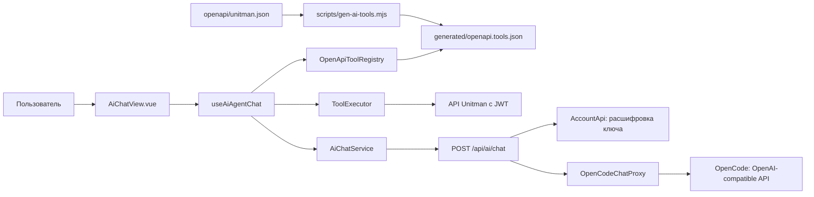

# AI-чат с инструментами из OpenAPI

Экран `/ai/chat` позволяет разговаривать с моделью, которая умеет **вызывать
реальные операции бэкенда Unitman**. Инструменты для LLM не пишутся руками:
они собираются из снимка OpenAPI [`openapi/unitman.json`](../openapi/unitman.json)
по расширениям `x-ai-*`. Любая бизнес-настройка — какие операции доступны,
каким ролям, что требует подтверждения и какие операции связаны — живёт
**только в спецификации**. В TypeScript и PHP нет захардкоженных списков
эндпоинтов.

План и обоснование решений — [`plans/ai-chat-openapi-tools.md`](../../plans/ai-chat-openapi-tools.md).

## 1. Архитектура и поток данных



Поток одного хода:

1. [`OpenApiToolRegistry`](../src/modules/ai-chat/services/OpenApiToolRegistry.ts:1)
   импортирует манифест
   [`generated/openapi.tools.json`](../src/modules/ai-chat/generated/openapi.tools.json),
   который на этапе сборки подготовил
   [`scripts/gen-ai-tools.mjs`](../scripts/gen-ai-tools.mjs): `$ref` уже
   развёрнуты, а в манифесте оставлены только операции с `x-ai-enabled: true`.
   Реестр строит по нему метаданные инструментов; в браузере
   `@apidevtools/swagger-parser` **не вызывается**.
2. [`useAiAgentChat`](../src/modules/ai-chat/composables/useAiAgentChat.ts:1)
   ведёт ReAct-цикл. На каждом шаге модели отправляется `search_api_endpoints`
   плюс уже активированные инструменты сессии.
3. [`AiChatService`](../src/modules/ai-chat/services/AiChatService.ts:1)
   отправляет историю и инструменты в `POST /api/ai/chat`.
4. Бэкенд [`AiChatController`](../../unitman/src/AiChat/Infra/Controller/AiChatController.php:1)
   расшифровывает ключ пользователя через
   [`AccountApi::poluchitRekvizityOpenCodeDlyaTekuschegoPolzovatelya()`](../../unitman/src/Account/Api/AccountApi.php:114)
   и ретранслирует запрос в [`OpenCodeChatProxy`](../../unitman/src/AiChat/Infra/Service/OpenCodeChatProxy.php:1).
5. Если модель вернула `tool_calls`, [`ToolExecutor`](../src/modules/ai-chat/services/ToolExecutor.ts:1)
   выполняет их через обычный `apiClient.requestRaw()` — с JWT пользователя и
   против настоящего API. Результат возвращается модели как `role: "tool"`.

Активация инструментов двухступенчатая: сначала модель вызывает
`search_api_endpoints`, реестр находит операции и активирует их вместе с
рекурсивными `x-ai-deps`, и только после этого определения инструментов
попадают в следующий запрос к модели.

## 2. Как открыть новый эндпоинт для AI

### Шаг 1. Разметить PHP-атрибут `OA\*`

Источник истины — атрибуты swagger-php. Расширения задаются картой `x:`; ключ
`ai-enabled` превращается в `x-ai-enabled`, `ai-roles` — в `x-ai-roles` и т.д.

```php
#[OA\Post(
    path: '/api/project/add',
    summary: 'Добавить проект',
    tags: ['Project'],
    x: [
        'ai-enabled' => true,
        'ai-roles' => [],
        'ai-confirm' => true,
        'ai-deps' => [
            'post_app_unitman_infra_repo_list',
            'post_app_unitman_infra_repo_typelist',
        ],
    ],
    // requestBody / responses ...
)]
#[Route('/add', methods: ['POST'])]
public function add(/* ... */): Response
{
    // ...
}
```

В сгенерированном JSON это выглядит так:

```json
{
  "operationId": "post_app_unitman_infra_project_add",
  "x-ai-enabled": true,
  "x-ai-roles": [],
  "x-ai-confirm": true,
  "x-ai-deps": [
    "post_app_unitman_infra_repo_list",
    "post_app_unitman_infra_repo_typelist"
  ]
}
```

Атрибуты обязательно должны стоять на операции, а не на всём контроллере.

### Шаг 2. Перегенерировать бэкенд-спецификацию

```bash
cd unitman
composer openapi-dump
```

Скрипт `openapi-dump` в [`composer.json`](../../unitman/composer.json:106)
выполняет `cache:clear --no-warmup` и
`nelmio:apidoc:dump --format=json > docs/openapi.json`, то есть обновляет
[`unitman/docs/openapi.json`](../../unitman/docs/openapi.json).

Проверить, что закоммиченный файл не отстал от атрибутов:

```bash
cd unitman
composer check-openapi
```

### Шаг 3. Скопировать снимок во фронтенд

Бэкенд и фронтенд — разные приложения, поэтому спецификация копируется в
[`unitman-front/openapi/unitman.json`](../openapi/unitman.json). Из корня
workspace:

```bash
cp unitman/docs/openapi.json unitman-front/openapi/unitman.json
```

Или из каталога `unitman-front`:

```bash
cd unitman-front
cp ../unitman/docs/openapi.json openapi/unitman.json
```

Снимок коммитится в репозиторий и **не редактируется вручную**. Именно из него
генерируется манифест AI-инструментов, из которого `OpenApiToolRegistry` читает
`x-ai-*` во время выполнения.

### Шаг 4. Сгенерировать манифест AI-инструментов

```bash
cd unitman-front
yarn gen:ai-tools
yarn gen:ai-tools:check
```

`yarn gen:ai-tools` запускает
[`scripts/gen-ai-tools.mjs`](../scripts/gen-ai-tools.mjs) и перезаписывает
[`src/modules/ai-chat/generated/openapi.tools.json`](../src/modules/ai-chat/generated/openapi.tools.json).
Скрипт:

* читает снимок [`openapi/unitman.json`](../openapi/unitman.json);
* разворачивает `$ref` через `@apidevtools/swagger-parser` **в Node**, с
  отключёнными `file`/`http`-резолверами (`dereference: {circular: 'ignore'}`);
* оставляет только операции с `x-ai-enabled: true` вместе с `x-ai-*`,
  `parameters`, `requestBody`, `operationId`, `summary`, `description` и
  `tags`, сохраняя шаблонные `parameters` уровня пути;
* пишет результат в формате `{openapi, paths}` детерминированно (2 пробела,
  стабильный порядок ключей, перевод строки в конце), чтобы `--check` не
  «мигал».

Манифест — это **build-time замена** вызова `SwaggerParser.dereference()` в
браузере. Раньше реестр разворачивал снимок во время выполнения, а
`@apidevtools/swagger-parser` и его `json-schema-ref-parser` обращаются к
Node-глобали `Buffer`; в браузере это давало ошибку
«Не удалось выполнить запрос к AI-чату. Buffer is not defined» ещё до запроса к
`/api/ai/chat`. Теперь парсер остаётся только в devDependency и в
Node-скрипте, а клиент импортирует обычный JSON.

`yarn gen:ai-tools:check` ничего не пишет: он генерирует строку в памяти и
сравнивает её с файлом, завершаясь с кодом 1 и сообщением
«[gen-ai-tools] src/modules/ai-chat/generated/openapi.tools.json устарел. Выполните `yarn gen:ai-tools` и закоммитьте обновлённый манифест.». Эта проверка
входит в `yarn build` и выполняется **до** `vue-tsc`, поэтому устаревший
манифест ломает сборку. Сгенерированный файл коммитится вместе со снимком и
**не** добавлен в `.gitignore`.

### Шаг 5. Перегенерировать типы и проверить

```bash
cd unitman-front
yarn gen:api --offline
yarn gen:api:check
yarn build
```

`yarn gen:api` обновляет [`src/api/generated/unitman.d.ts`](../src/api/generated/unitman.d.ts);
`--offline` заставляет генератор взять локальный снимок без сети.
`yarn gen:api:check` сравнивает **сгенерированные типы со снимком** и падает с
кодом возврата 1, если `.d.ts` устарел. Он не проверяет расхождение снимка с
живым бэкендом — за это отвечает `composer check-openapi` на бэкенде.

Порядок при обновлении снимка важен: сначала `yarn gen:ai-tools` (манифест
инструментов), затем `yarn gen:api` (типы API), затем `yarn build`.

## 3. Расширения `x-ai-*`

| Поле | Тип | Семантика |
|---|---|---|
| `x-ai-enabled` | boolean | В реестр попадают только операции со значением ровно `true`. Отсутствие поля или любое другое значение означает «не инструмент». |
| `x-ai-roles` | string[] | Семантика **any-of**: достаточно совпадения хотя бы одной роли. Пустой массив (или отсутствие поля) — доступно любому авторизованному пользователю. Регистр и пробелы нормализуются. |
| `x-ai-confirm` | boolean | При `true` цикл приостанавливается и ждёт подтверждения пользователя **до** HTTP-вызова. Исполнитель сам подтверждение не показывает и без флага `confirmed` возвращает `confirmation_required`. |
| `x-ai-deps` | string[] | Канонические `operationId` операций, которые нужно активировать вместе с этой. Активация рекурсивная, защищена от циклов и тоже фильтруется по ролям. Отсутствующая, выключенная или запрещённая зависимость пропускается с `console.warn`. |
| `x-ai-name` | string (необязательно) | Явное имя инструмента для LLM. Должно соответствовать `^[A-Za-z0-9_-]{1,64}$`. Если поля нет или оно невалидно, имя выводится из `operationId`. |

Правила именования инструмента:

1. Если `x-ai-name` — строка, прошедшая `^[A-Za-z0-9_-]{1,64}$`, используется
   она.
2. Иначе `operationId` нормализуется: всё вне `[A-Za-z0-9_]` заменяется на
   `_`, повторы `_` схлопываются, ведущие и хвостовые `_` удаляются.
3. Если результат длиннее 55 символов, он обрезается и дополняется `_` и
   стабильным 8-символьным FNV-1a-хешем от исходного `operationId`.
4. Если после нормализации строка пустая, операция пропускается с
   предупреждением в консоли.

Для текущих пяти операций `operationId` уже состоят из допустимых символов и
короче лимита, поэтому имя инструмента совпадает с `operationId`.

### Текущий набор операций

| `operationId` | Метод и путь | `x-ai-enabled` | `x-ai-roles` | `x-ai-confirm` | `x-ai-deps` |
|---|---|---|---|---|---|
| `post_app_unitman_infra_repo_typelist` | `POST /api/repo/type/list` | `true` | `[]` | `false` | `[]` |
| `post_app_unitman_infra_repo_list` | `POST /api/repo/list` | `true` | `[]` | `false` | `[]` |
| `post_app_unitman_infra_project_list` | `POST /api/project/list` | `true` | `[]` | `false` | `[]` |
| `post_app_unitman_infra_project_add` | `POST /api/project/add` | `true` | `[]` | `true` | `["post_app_unitman_infra_repo_list", "post_app_unitman_infra_repo_typelist"]` |
| `get_app_runner_infra_runner_list` | `GET /api/runner/list` | `true` | `["ROLE_ADMIN"]` | `false` | `[]` |

Связка «справочник → действие»: чтобы создать проект, модель сначала активирует
`post_app_unitman_infra_project_add`, а вместе с ним автоматически —
`post_app_unitman_infra_repo_list` и `post_app_unitman_infra_repo_typelist`.
Это позволяет модели узнать реальные `id` репозитория и типа, а не выдумывать
их. Операция создания помечена `x-ai-confirm: true`, поэтому HTTP-мутация
выполняется только после явного подтверждения.

Инструмент списка раннеров помечен `x-ai-roles: ["ROLE_ADMIN"]`: он
отфильтровывается ещё при построении индекса и не виден остальным
пользователям.

### Как строится JSON Schema инструмента

Для каждой операции реестр автоматически собирает аргументы:

* Объединяются `parameters` уровня пути и уровня операции (по паре
  `in:name`, побеждает операция).
* Поддерживаются только `path` и `query`; прочие расположения игнорируются.
* `application/json` (или первый доступный media type) тела разворачивается в
  отдельные аргументы по свойствам объекта; `required` берётся из схемы тела.
* Не-объектное тело (массив, строка, число) представляется одним аргументом с
  именем `body` (при коллизии — `body_body` и далее); для него в маппинге
  `sourceName` пустой, и исполнитель передаёт значение как всё тело целиком.
* Коллизии имён разрешаются суффиксами: обычные аргументы получают `_2`,
  `_3`, body-аргументы — `_body`, `_body2`.
* Схемы санитизируются: остаются только `type`, `description`, `enum`,
  `properties`, `items`, `required`; `nullable`, `example`, `x-*`, `$ref`
  и прочие расширения отбрасываются. Глубина ограничена 4, циклы
  отслеживаются через `WeakSet`.
* `oneOf`/`anyOf` сворачиваются в первый **непустой** санитизированный
  вариант, `allOf` объединяется. `type: ["string", "null"]` сводится к
  `string`.
* Описание инструмента — это `summary`, затем `description` (если отличается),
  затем `Tags: ...` и строка `HTTP <METHOD> <path>`.

`search_api_endpoints` — единственный инструмент, который доступен модели
всегда. Он описан константой `META_SEARCH_TOOL` в реестре и имеет один
аргумент `query`. Поиск идёт по `summary` (вес 0.5), `tags` (0.3) и
`description` (0.2); `threshold: 0.4`, `ignoreLocation: true`,
`minMatchCharLength: 2`, по умолчанию возвращается топ-5. Найденные операции и
все их зависимости активируются.

До активации модель **не видит** инструмент: `getTools()` возвращает только
`search_api_endpoints` и операции текущей сессии.

## 4. Поведение во время выполнения

### ReAct-цикл и лимит шагов

[`useAiAgentChat`](../src/modules/ai-chat/composables/useAiAgentChat.ts:1)
выполняет до **10** вызовов модели на один ход пользователя
(`export const MAX_STEPS = 10`). Лимит проверяется **до** очередного запроса,
поэтому 11-й вызов не уходит ни при каких условиях. При достижении лимита в
ленту добавляется служебное уведомление `step_limit_reached`. То же значение
продублировано в бэкенд-DTO
[`AiChatRequest::MAX_STEPS`](../../unitman/src/AiChat/Infra/Command/AiChatRequest.php:42)
как единая точка правды, но из тела запроса оно не принимается.

На каждом шаге:

1. `AiChatService.chat()` получает `messages`, `tools = getTools()`, а также
   необязательные `model` и `credentialId`.
2. Ответ модели добавляется в `llmMessages`; текст — в ленту UI.
3. `tool_calls` выполняются строго последовательно.
4. Для инструмента с `x-ai-confirm` цикл ждёт Promise, который разрешают
   `confirmToolCall()` или `cancelToolCall()`; HTTP-вызова в это время ещё нет.
5. Результат каждого вызова добавляется как `role: "tool"` с тем же
   `tool_call_id`, после чего цикл повторяется.

### Обрезка результатов

[`ToolExecutor`](../src/modules/ai-chat/services/ToolExecutor.ts:1) ограничивает
то, что увидит модель:

| Константа | Значение | Назначение |
|---|---|---|
| `MAX_TOOL_RESULT_CHARS` | `20_000` символов (~20 КБ) | Верхняя граница содержимого одного tool-сообщения. |
| `MAX_TOOL_RESULT_ARRAY_ITEMS` | `50` | Массивы длиннее сворачиваются в конверт `{truncated, notice, totalItems, items}`. |
| `MAX_FOLD_DEPTH` | `6` | Глубина рекурсивного сворачивания вложенных массивов. |
| `TRUNCATION_ENVELOPE_RESERVE` | `512` | Запас под служебный конверт при обрезке по размеру. |

Если сериализованный JSON всё равно длиннее лимита, вместо структуры
возвращается валидный JSON-конверт с `notice`, `originalLength` и `preview`.
Модель понимает, что данные неполные, и может сузить запрос. В UI результат
обрезается отдельно до `MAX_UI_TOOL_RESULT_CHARS = 600`.

### Маппинг аргументов

* `path`-аргументы подставляются во все вхождения `{sourceName}` с
  `encodeURIComponent`; массивы склеиваются через запятую, объекты
  сериализуются в JSON. Оставшиеся неразвёрнутые плейсхолдеры удаляются.
* `query`-аргументы собираются в `URLSearchParams`; массивы разворачиваются в
  повторяющиеся ключи.
* `body`-аргументы собираются в объект по исходным именам (`sourceName`), а не
  по именам аргументов, которые видит LLM. Если у операции единственный
  аргумент с пустым `sourceName`, значение передаётся как всё тело.
* Для `GET` тело не отправляется.
* Ведущий `/api` из пути снимка снимается, потому что `VITE_API_HOST` уже
  содержит `/api`; иначе получился бы `/api/api/...`.

### Контракт `POST /api/ai/chat`

Запрос:

```json
{
  "messages": [
    {"role": "user", "content": "Создай проект..."}
  ],
  "tools": [
    {"type": "function", "function": {"name": "search_api_endpoints", "parameters": {}}}
  ],
  "model": "gpt-4o-mini",
  "credentialId": "optional-id",
  "sessionId": "0f8fad5b-d9cb-469f-a165-70867728950e"
}
```

Ограничения [`AiChatRequest`](../../unitman/src/AiChat/Infra/Command/AiChatRequest.php:16):

| Поле | Правило |
|---|---|
| `messages` | Обязательный непустой список, не более `MAX_MESSAGES = 100`. |
| `messages[].role` | Одно из `system`, `user`, `assistant`, `tool`. |
| `messages[].content` | `string` или `null`, не длиннее `MAX_MESSAGE_LENGTH = 100_000` символов. |
| `tools` | Необязательный список, не более `MAX_TOOLS = 64`. |
| `tools[].type` | Непустая строка; для `type = "function"` имя обязано соответствовать `^[A-Za-z0-9_-]{1,64}$`. |
| `model` | Необязательная строка до `MAX_MODEL_LENGTH = 128`. |
| `credentialId` | Необязательная строка до `MAX_CREDENTIAL_ID_LENGTH = 128`. |
| `sessionId` | Необязательная строка, соответствующая `^[A-Za-z0-9._:-]{1,128}$`; пересылается как `x-opencode-session` только для `opencode-go`. |

Пустые строки `model`/`credentialId` нормализуются в `null`. Число шагов
цикла в запросе не передаётся.

Ответ при успехе — JSON OpenAI-совместимого API (`choices`, `usage` и т.д.) со
статусом upstream. Если upstream вернул прикладную ошибку, её статус и тело
ретранслируются как есть. Ошибки самого прокси:

| Ситуация | Статус | Устойчивый ключ (`code`) |
|---|---|---|
| Нет аутентифицированного пользователя | `401` | `account.not_authenticated` |
| Некорректное тело или превышение лимитов | `422` | `ai.chat.invalid_payload` |
| У пользователя нет реквизитов OpenCode | `422` | `ai.chat.credential_required` |
| Запрошенная модель недоступна в реквизитах | `422` | `account.opencode_credential.model_not_available` |
| Не настроен ни URL реквизитов, ни `OPENCODE_API_URL` | `422` | `ai.chat.upstream_not_configured` |
| Транспортная ошибка до upstream | `502` | `ai.chat.upstream_unavailable` |
| Upstream вернул не-JSON или тело больше 10 МиБ | `502` | `ai.chat.upstream_invalid_response` |

Приоритет базового URL: `url` выбранных реквизитов, если он непустой; иначе
`OPENCODE_API_URL` из окружения. Таймаут задаётся `AI_CHAT_TIMEOUT` (в
`.env.dist` — `60` секунд) и связывается в
[`di.php`](../../unitman/src/AiChat/di.php:9) как `%env(float:AI_CHAT_TIMEOUT)%`.

### Ошибки upstream и `errorDetails`

[`OpenCodeChatProxy`](../../unitman/src/AiChat/Infra/Service/OpenCodeChatProxy.php:67)
ретранслирует статус и тело прикладной ошибки провайдера без изменений: если
upstream ответил `400`, клиент получит `400`, а не переупакованный статус.
Контроллер сам возвращает только `401`, `422` и `502` (см. таблицу выше).

Чтобы пользователь видел причину, [`AiChatService`](../src/modules/ai-chat/services/AiChatService.ts:198)
извлекает текст провайдера через
[`normalizovatOshibkuChat()`](../src/modules/ai-chat/services/AiChatErrorNormalizer.ts:120)
в [`AiChatResult.errorDetails`](../src/modules/ai-chat/model/types.ts:223).
Приоритет полей: `error.message` → `message` → `data.message` →
`data.error.message`; пустые строки и не-строковые значения игнорируются. В
[`SoobshenieChata.vue`](../src/modules/ai-chat/view/components/SoobshenieChata.vue:1)
этот `details` рендерится как обычный текст рядом с локализованным ключом
ошибки и `HTTP {status}`. Для нераспознанных `4xx/5xx` используется ключ
`ai.chat.upstream_error` («Провайдер AI вернул ошибку. Текст ошибки приведён
ниже.» / «The AI provider returned an error. See the provider message below.»).

Для разбора инцидента прокси пишет `warning` `AI chat upstream request failed.`
с полями `status`, `provider`, `error.message` и `error.code`. API-ключи,
заголовки, тела запросов и ответов и содержимое сообщений в лог **не
попадают** — это осознанное требование stateless-воркеров RoadRunner.

### Провайдер и заголовки авторизации

`provider` реквизитов передаётся в
[`OpenCodeChatProxy::otpravit()`](../../unitman/src/AiChat/Infra/Service/OpenCodeChatProxy.php:67)
и определяет заголовок авторизации:

| `provider` | Авторизация |
|---|---|
| `anthropic` | `x-api-key: <key>` и `anthropic-version: 2023-06-01`, без `Authorization` |
| `ollama`, `custom` | без заголовка авторизации |
| остальные (`openai`, `opencode` и т.д.) | `Authorization: Bearer <key>` |

URL всегда собирается как `rtrim($baseUrl, '/') . '/chat/completions'`. Для
`opencode` в
[`ProvayderOpenCode::baseUrl()`](../../unitman/src/Account/Business/Model/OpenCode/ProvayderOpenCode.php:68)
задан `https://api.opencode.ai/v1`, поэтому запрос уходит на
`https://api.opencode.ai/v1/chat/completions`.

### Сессия `opencode-go` и `x-opencode-session`

`opencode-go` — session-scoped шлюз (`https://opencode.ai/inference/go/openai/v1`):
для `chat/completions` ему нужен идентификатор сессии, иначе он отвечает
`400 Request is missing x-opencode-session and cannot be routed efficiently`.

Теперь `opencode-go` поддержан на уровне диалога:

* [`useAiAgentChat`](../src/modules/ai-chat/composables/useAiAgentChat.ts:1)
  заводит один `sessionId` на диалог через `crypto.randomUUID()` (fallback —
  `ai-<timestamp>-<random>`) и включает его в **каждое** обращение к
  [`AiChatService.chat()`](../src/modules/ai-chat/services/AiChatService.ts:140).
  `reset()` генерирует новый id, поэтому следующий диалог получает новую
  сессию.
* [`AiChatService`](../src/modules/ai-chat/services/AiChatService.ts:140)
  отправляет `sessionId` в JSON-теле запроса `POST /api/ai/chat`; собственный
  HTTP-заголовок фронтенд не добавляет.
* Бэкенд [`OpenCodeChatProxy`](../../unitman/src/AiChat/Infra/Service/OpenCodeChatProxy.php:67)
  пересылает значение как `x-opencode-session` **только** для
  `provider === 'opencode-go'`; остальные провайдеры этот заголовок не получают.

Допустимый формат `sessionId`: `^[A-Za-z0-9._:-]{1,128}$` (защита от header
injection), не длиннее 128 символов. Невалидное значение даёт
`422 ai.chat.invalid_payload`.

Если `opencode-go` всё равно требует официальную сессию OpenCode и отвечает
`MissingSessionID`, это не ошибка ключа и не ошибка модели — для AI-чата
выберите обычные OpenAI-совместимые реквизиты (`openai`, `openrouter`,
`deepseek`, `groq`, `xai`, `together`, `google`, `anthropic`, `ollama` или
`custom`-URL).

Выбранная модель **обязана поддерживать `tools`/function calling**: иначе
провайдер отклонит запрос (часто `400`) или проигнорирует инструменты.

### Stateless-требование RoadRunner

Воркеры RoadRunner долго живут и переиспользуются между запросами разных
пользователей, поэтому:

* у контроллера, DTO и прокси нет изменяемых свойств с per-request данными;
* ключ, заголовки `Authorization`, сообщения, инструменты, модель и базовый URL
  существуют только как локальные переменные и параметры;
* текущий пользователь приходит через `#[CurrentUser]`, а ключ расшифровывается
  в `AccountApi` на время запроса;
* заголовки и содержимое сообщений не логируются.

Это покрыто тестом
[`test_dva_zaprosa_s_raznimi_rekvizitami_ne_teku_drug_v_druga()`](../../unitman/src/AiChat/Tests/Infra/Controller/AiChatControllerTest.php:206):
два последовательных запроса с разными пользователями, реквизитами и моделями
не должны обменяться ключами, URL, заголовками или телами.

## 5. Ограничения

* Достижимы только операции с `x-ai-enabled: true`; остальные не существуют
  для модели.
* Инструмент становится виден модели только после активации через
  `search_api_endpoints` (или через `x-ai-deps` уже активированной операции).
* Не более 10 шагов модели на один ход пользователя.
* Содержимое одного результата инструмента ограничено ~20 КБ; длинные массивы
  сворачиваются.
* Не-объектное тело запроса описывается одним аргументом `body`, а не набором
  полей.
* Стриминга нет: прокси получает ответ целиком и ретранслирует его.
* Модель не видит инструменты, которые ещё не активированы, и не может
  угадать их имена.
* Глубокие и рекурсивные схемы упрощаются санитизацией: глубина ограничена,
  циклы отбрасываются, неподдерживаемые ключи удаляются.
* `oneOf`/`anyOf` сводятся к первому непустому варианту, поэтому модель видит
  только одну ветку.
* Отказ пользователя или остановка хода передаются модели как результат с
  `ok: false`, `cancelled: true`; модель не должна повторять действие
  автоматически.

## 6. Безопасность

* **JWT пользователя прикладывается к каждому вызову инструмента.**
  `ToolExecutor` использует `apiClient.requestRaw()`, который подставляет
  `Authorization: Bearer <token>` и обновляет токен так же, как остальное
  приложение. Модель может сделать только то, что разрешено пользователю;
  серверная авторизация остаётся единственным источником истины.
* **`x-ai-roles` — это фильтр видимости, а не граница безопасности.** Он
  убирает инструмент из контекста LLM и индекс поиска, но не заменяет проверки
  прав на бэкенде. Любой пользователь, обошедший UI, всё равно упрётся в
  серверные политики.
* **`x-ai-confirm` защищает разрушающие операции.** Подтверждение проверяется в
  цикле до HTTP-вызова и повторно в исполнителе: без `confirmed: true`
  инструмент вернёт `confirmation_required`. Хук подтверждения нельзя
  обходить или выполнять вызов «в обход карточки».
* **Ключ OpenCode не покидает бэкенд.** Он расшифровывается только в
  `AccountApi` на время запроса, не отдаётся браузеру и не хранится в свойствах
  сервисов; в прокси он живёт локальной переменной.
* **Вывод модели и результаты инструментов рендерятся как обычный текст.**
  `SoobshenieChata.vue` и `StrokaInstrumenta.vue` используют интерполяцию
  `{{ }}` и принципиально не применяют `v-html`, поэтому HTML/скрипты из
  ответа провайдера или API не исполняются.
* **Ревьюируйте каждый новый включённый эндпоинт.** Особенно мутирующие:
  для них следует требовать `x-ai-confirm: true` и убедиться, что серверные
  права ограничивают действие.

## 7. Диагностика

### Разбор `HTTP 400`

`400` — это ответ провайдера, ретранслированный прокси, а не ошибка
контроллера Unitman (тот возвращает только `401`, `422` и `502`). Обычно он
означает:

* некорректную форму запроса (неподдерживаемое поле, лишний параметр);
* несуществующую у провайдера или недоступную ключу модель, неподдерживаемые
  параметры;
* модель **без поддержки `tools`/function calling** — самая частая причина,
  когда в запросе есть `tools`;
* неподходящий способ авторизации для выбранного `provider`;
* отсутствие `/v1` в базовом URL `opencode`;
* session-scoped шлюз `opencode-go` (`MissingSessionID`).

Где смотреть:

1. **UI.** Баннер ошибки показывает локализованный ключ, `HTTP {status}` и
   дословный текст провайдера (`details`, см. `errorDetails`). Если `details`
   пуст, провайдер не вернул текстового `message`.
2. **Логи бэкенда.** Ищите `warning` `AI chat upstream request failed.` с
   полями `status`, `provider`, `error.message`, `error.code`. Заголовков,
   ключей и тел там нет намеренно.

| Симптом | Что проверить |
|---|---|
| Эндпоинт помечен, но инструмента нет | `x-ai-enabled` должно быть ровно `true`; операция должна иметь непустой `operationId`; проверьте роли в `x-ai-roles` и роли из JWT; перегенерируйте `docs/openapi.json`, скопируйте снимок, выполните `yarn gen:ai-tools` и `yarn gen:api --offline`. |
| Инструмент есть в поиске, но модель его не вызывает | Убедитесь, что модель сначала вызвала `search_api_endpoints`; до активации инструмент не отправляется в запросе. Также проверьте, не истёк ли лимит шагов. |
| `422 ai.chat.credential_required` | У пользователя нет реквизитов OpenCode: создайте их в настройках аккаунта или передайте корректный `credentialId`. |
| `422 account.opencode_credential.model_not_available` | Выбранная модель отсутствует в `models` реквизитов; выберите модель из списка или измените реквизиты. |
| `422 ai.chat.upstream_not_configured` | Пусты и `url` реквизитов, и `OPENCODE_API_URL`; задайте хотя бы одно значение. |
| `502 ai.chat.upstream_unavailable` | Проверьте `OPENCODE_API_URL` / URL реквизитов, доступность провайдера и `AI_CHAT_TIMEOUT`. |
| `502 ai.chat.upstream_invalid_response` | Upstream вернул не-JSON или тело больше 10 МиБ; проверьте URL (нужен базовый URL OpenAI-совместимого API, без `/chat/completions`) и ответ провайдера. |
| В UI показан `HTTP 400` с текстом провайдера | `400` пришёл от провайдера и ретранслирован как есть; подробности — в `details` ошибки и в `warning` `AI chat upstream request failed.` (`status`, `provider`, `error.message`, `error.code`). См. «Разбор `HTTP 400`» выше. |
| Upstream вернул `400` с `MissingSessionID` (или другой ошибкой сессии) | Реквизиты указывают на session-scoped шлюз — `opencode-go` (`https://opencode.ai/inference/go/openai/v1`). Фронтенд уже передаёт per-dialog `sessionId`, а прокси отправляет его как `x-opencode-session`; если шлюз всё равно требует официальную сессию OpenCode, это не ошибка ключа/модели — выберите обычные OpenAI-совместимые реквизиты (`openai`, `openrouter`, `deepseek`, `groq`, `xai`, `together`, `google`, `anthropic`, `ollama` или `custom`-URL) либо задайте `OPENCODE_API_URL`. Помните: `url` реквизитов имеет приоритет над `OPENCODE_API_URL`. |
| Провайдер ждёт `x-api-key` или не требует авторизации | Прокси выбирает заголовок по `provider`: `anthropic` → `x-api-key` + `anthropic-version: 2023-06-01` (без `Authorization`); `ollama`/`custom` → без авторизации; остальные → `Authorization: Bearer`. Если провайдер не принимает такой способ, используйте `custom` с URL, понимающим Bearer, или смените провайдера. Не добавляйте произвольный проброс заголовков без ревью дизайна и никогда не логируйте заголовки и ключи. |
| В UI показан `MissingSessionID` | Это дословная ретрансляция ответа upstream: статус и тело прикладной ошибки передаются как есть по дизайну. Текст `MissingSessionID` — сообщение upstream/провайдера, а не баг фронтенда или прокси. |
| `Buffer is not defined` при отправке сообщения | В клиентский бандл попал runtime-вызов `SwaggerParser.dereference()`. Реестр должен импортировать `generated/openapi.tools.json`, а `@apidevtools/swagger-parser` — оставаться только в `scripts/gen-ai-tools.mjs`. Удалите импорт парсера из `src/`, выполните `yarn gen:ai-tools` и проверьте `grep -rn "swagger-parser" dist`. |
| `yarn gen:ai-tools:check` падает | Манифест `src/modules/ai-chat/generated/openapi.tools.json` устарел относительно `openapi/unitman.json`: выполните `yarn gen:ai-tools` и закоммитьте файл. |
| `yarn gen:api:check` падает | Снимок и сгенерированные типы разошлись: выполните `yarn gen:api --offline` и закоммитьте `src/api/generated/unitman.d.ts` вместе с `openapi/unitman.json`. |
| `composer check-openapi` падает | `docs/openapi.json` устарел: выполните `composer openapi-dump` и закоммитьте результат. |
| Имя инструмента отклонено или операция пропущена | `operationId`/`x-ai-name` должен соответствовать `^[A-Za-z0-9_-]{1,64}$`; при невалидном `x-ai-name` имя выводится из `operationId`, а полностью пустое имя приводит к пропуску операции с предупреждением в консоли. |

## 8. Проверки перед коммитом

```bash
# бэкенд
cd unitman
composer openapi-dump
composer check-openapi
composer check-phpunit

# снимок во фронтенд
cd ..
cp unitman/docs/openapi.json unitman-front/openapi/unitman.json

# фронтенд
cd unitman-front
yarn gen:ai-tools
yarn gen:ai-tools:check
yarn gen:api --offline
yarn gen:api:check
yarn check:i18n
yarn build
```
